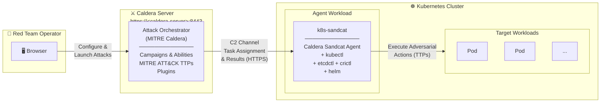

# KubeBreach

* Emulating breaches in Kubernetes
* Adversarial Emulation for k8s workloads

# High Level Architecture

| Component | Role |
|-----------|------|
| [Caldera-Server](https://github.com/mitre/caldera) | Central attack orchestrator; manages adversarial campaigns, abilities, and results |
| [K8s-Sandcat](https://github.com/accuknox/k8s-sandcat) | Caldera Sandcat agent deployed inside the cluster; bundles Kubernetes tools ([kubectl](https://kubernetes.io/docs/reference/kubectl/), [etcdctl](https://etcd.io/docs/v3.5/dev-guide/interacting_v3/), [crictl](https://github.com/kubernetes-sigs/cri-tools), [helm](https://helm.sh/)) alongside [MITRE Caldera Sandcat](https://github.com/mitre/sandcat) to drive k8s adversarial TTPs |

# Emulating Adversarial behaviour in k8s workloads

## Hashicorp Vault

